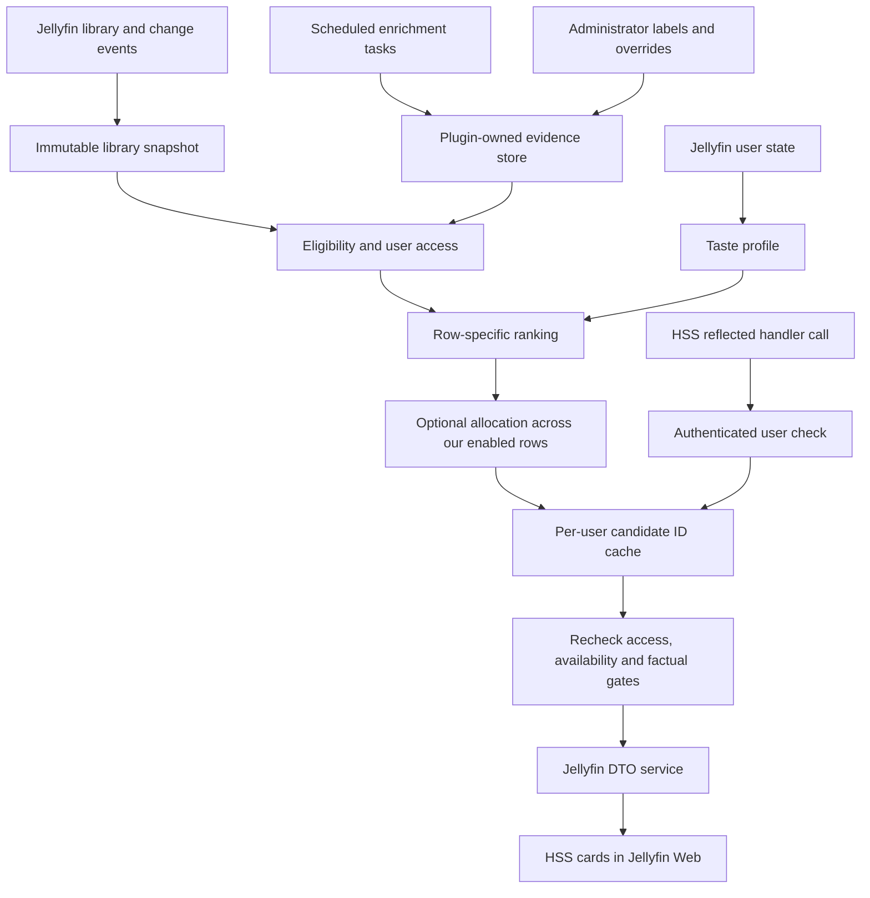

# Implementation plan

Authoritative workspace: `/home/diverse/Projects/jellyfin-plugin-discovery-rows`.

Target: **Jellyfin 10.11.11, HSS 3.0.2.0, Jellyfin Web 10.11.11**. Plugin name: **Discovery Rows**. Date: **11 October 2026, Australia/Perth**. This is the original design record; version 1.0.0 is now implemented. See [verification](VERIFICATION.md) for the actual shipped scope and runtime evidence.

The release-specific evidence and its limits are in [Research](RESEARCH.md); row requirements are in [Catalogue](ROW_CATALOGUE.md); implementation tickets are in [Backlog](BACKLOG.md). Source revisions and URLs are pinned in [source-lock.json](research/source-lock.json).

## 1. Product and release decisions

Build one independently installed server plugin. It adds stable shelves to HSS and personalizes their contents using only media the requesting user may access. Prefer a small number of shared selectors with different parameters over one algorithm per heading.

Version 0.1 proves the integration and delivers dependable time/genre rows without an API key. Version 0.2 adds reviewed mood tags and optional TMDB quality enrichment, reaching 15 selectable definitions. Version 0.3 adds verified awards and complete limited-series rows. Richer niches and page composition follow after those foundations work.

Recommend enabling 6–10 discovery shelves through HSS, alongside continue watching and next up. This is a setup recommendation, not an automatic whole-page feature in version 1. Provide a preset guide with suggested distinct order indices so HSS does not shuffle every row into a single group.

Version 1 owns candidate selection, row scores, and explanations. HSS owns row visibility preferences, ordering, card presentation, and existing core shelves. Do not overwrite HSS's settings files or mutate globally registered section titles per user. Defer automatic row choice/reordering until HSS offers a suitable supported factory interface or an independently reviewed upstream change.

The full supplied catalogue remains a menu for later definitions. Netflix category codes are research provenance only. No Netflix runtime dependency is involved.

## 2. Architecture

Use C# with `net9.0` and exact Jellyfin 10.11.11 package references. Follow the official template's host-assembly runtime exclusions and embedded configuration-page pattern. Do not reference or bundle the HSS DLL; isolate reflection in a small adapter.

Planned solution boundaries:

| Project/component | Responsibility |
|---|---|
| `DiscoveryRows.Core` | Typed definitions, evidence resolution, eligibility, scores, logical identities, explanations and deterministic allocation. No HSS or Jellyfin entities. |
| `Jellyfin.Plugin.DiscoveryRows` | Plugin class, configuration, DI registration, Jellyfin queries/events/DTOs, evidence persistence, HSS reflection and administrator controller/page. |
| `DiscoveryRows.Core.Tests` | Meaningful behavior tests for selectors, score confidence, completeness, identity and allocation. |
| `Jellyfin.Plugin.DiscoveryRows.Tests` | Request guard, invalidation, adapter error handling and integration boundary tests. |
| `dev/` | Disposable server fixture, exact companion-plugin assets and integration instructions. No production mounts. |

Prefer explicit services: `LibrarySnapshotService`, `EvidenceStore`, `EvidenceResolver`, `UserAccessService`, `TasteProfileService`, `RowEvaluator`, `RowAllocationService`, `RecommendationCache`, `HssBridge`, and `ExplanationService`. Use immutable records in snapshots and caches rather than live `BaseItem` references or cached personalized DTOs.

## 3. HSS registration and request contract

The contract below is established in the [pinned RegisterSection source](https://github.com/IAmParadox27/jellyfin-plugin-home-sections/blob/d9798e410cacd4b8fbac4f57fcf3d5c05dd42dbd/src/Jellyfin.Plugin.HomeScreenSections/PluginInterface.cs). Runtime compatibility is milestone M0.

1. Register our services through `IPluginServiceRegistrator`. Register `IHttpContextAccessor` if necessary. Keep the plugin class separate from the background/startup service.
2. A startup scheduled task discovers HSS across `AssemblyLoadContext.All` using its exact assembly name and interface type. Check the required reflected method and expected argument type, and resolve readiness after the HSS plugin initializes. Retry with a bounded cancellation-aware policy; expose a dashboard retry rather than looping forever.
3. Build the registration as a plain serialized JSON object. Construct the `JObject` using the reflected parameter type's `Parse(string)` method so the object belongs to HSS's expected load context. Do not assume our Newtonsoft instance is assignable. Prove this in M0.
4. Register each shelf with its frozen CSS-safe `sectionId`, fixed plain-text title, `limit: 1`, no header route initially, plugin assembly/class, and one public synchronous wrapper method for that row. Serialize registration calls. Keep a process-local successful-registration set; retry only failed ones.
5. HSS creates a short-lived result handler through DI. Thin methods such as `GetUnder90Movies(RowRequest request)` call the shared evaluator with a compile-time row key. This prevents client-controlled `AdditionalData` from changing which shelf is being evaluated. `AdditionalData` may contain a schema version for future use; it is not trusted configuration.
6. The method returns `QueryResult<BaseItemDto>` directly, never a Task. It checks authentication first, retrieves candidates from local services, validates the final items, and creates DTOs using the actual user. Exceptions inside our method become an empty result with a bounded diagnostic; exceptions constructing the handler must be caught by M0's integration checks.
7. Number of cards is our own row setting, default 16 and maximum 40. HSS's `limit` controls section instances and is effectively fixed to 1 for reflected external sections.
8. Disabled or unsupported rows return an empty result. Never replace the factual membership condition with a looser query. Register a fixed initial set across restarts; adding a new preset needs a new frozen ID and HSS setup/save.

Use letter-leading IDs such as `DiscoveryRowsUnder90Movies`. Keep them immutable when changing labels or algorithms. HSS uses IDs in CSS selectors and stored layout settings. No user input belongs in headings or registration class/method names.

Onboarding must tell the administrator to open HSS configuration, inspect the new rows, choose defaults/order/view mode, and save. Users then enable Modular Home and choose available shelves. Registration does not populate persisted HSS `SectionSettings` automatically. Test new installs and existing layouts separately.

The pinned settings endpoint also has a generic translation fallback for external rows. Add a narrow, capability-checked `HssLabelBridge` using the reflected `ITranslationManager` service and `UpdateTranslationPack`: seed our row-ID/title keys in HSS's installed language packs after initialization, using fixed English labels initially. Construct its JObject through the expected parameter type too. This is in-memory compatibility work, not a write to HSS files. Verify settings labels before shipping; if unavailable, expose the compatibility failure instead of advertising indistinguishable selectable shelves. Do not patch the controller or private translation fields. This bridge is distinct from the optional layout adapter.

## 4. Identity, access and local availability

The [HSS 3.0.2.0 results controller](https://github.com/IAmParadox27/jellyfin-plugin-home-sections/blob/d9798e410cacd4b8fbac4f57fcf3d5c05dd42dbd/src/Jellyfin.Plugin.HomeScreenSections/Controllers/HomeScreenController.cs) forwards a supplied user ID. Our callback must enforce equality with the authenticated `Jellyfin-UserId` claim through `IHttpContextAccessor`. Require a real, enabled user, even for an administrator request. Reject missing context/claim, empty IDs, API keys without a user, and mismatches before accessing caches. Non-HTTP background work uses a separate internal API and cannot call the public HSS handler with a fabricated payload.

Query with `InternalItemsQuery(user)`, permitted library roots, recursive movie/series/episode filters, and explicit exclusions for missing/virtual/placeholder items. Never use a null user or a server-wide fallback when a user lookup fails. Intersect a global snapshot with user-accessible IDs; never serialize that snapshot to a normal user's endpoint.

Immediately before delivery, resolve the candidate IDs again, check `IsVisibleStandalone(user)`, required episode access, local availability, watched state, and required evidence. Generate fresh DTOs with `IDtoService` and that user. A metadata cache may be shared; personalized candidate IDs, taste, feedback, and DTO results may not.

Version 1 supports indexed local files, not remote channels or download/request cards. Availability means a known local media source, excluding missing-file/virtual records; it cannot promise client codec compatibility. Record file checks in background and recheck shortlisted physical files where practical. Do not perform a full filesystem walk during a request.

Normalize logical titles by media type and verified provider ID, falling back to Jellyfin presentation grouping/local identity. Do not merge different provider records by title/year guesses. Editions/encodes share a discovery identity, but their runtimes remain separate.

**Runtime promise:** HSS's ordinary item card does not bind playback to our chosen media source. Therefore strict time shelves require every known selectable version to have a positive known runtime within the limit. A movie with an 88-minute cut and a 105-minute cut is excluded from “under 90” until a future client integration can select and identify the shorter edition. This conservative rule avoids promising a duration the normal playback path may exceed.

## 5. Data and persistence

Use the plugin data/configuration paths provided by Jellyfin. The XML `PluginConfiguration` holds small settings; a plugin-owned SQLite database stores evidence and optional feedback/history. Avoid direct SQL against Jellyfin's database. Package a compatible SQLite provider only after proving load-context and native-library behavior in M0; if that dependency causes conflicts, use atomic versioned JSON documents for the small 0.1 dataset and migrate behind `IEvidenceStore` before enrichment grows.

Planned records:

| Record | Key fields |
|---|---|
| `LocalMediaSnapshot` | Jellyfin ID, logical identity, type, provider IDs, library roots, genres/tags/people, source runtimes, episode coordinates, revisions. |
| `ProviderEvidence` | Provider/media type/ID, field, value, scale, vote count where relevant, fetched time, evidence URL, schema/provider version. |
| `FacetAssertion` | Work ID, facet, value, confidence, source, reviewer/model/rule version, input hash, reviewed time, superseded flag. |
| `AwardRecord` | Body, ceremony year, category, nominee/winner outcome, work ID, contribution, evidence URL and dataset version. |
| `EpisodeManifest` | Provider, order type, series/season ID, episode IDs/numbers, air dates, required-specials policy, fetched time and reconciliation status. |
| `UserFeedback` | User ID, logical work ID, explicit hide/like preference, timestamp. Add only when the self-service UI exists. |
| `RecommendationExplanation` | Row key, input revisions, passed gates, missing fields, component scores and evidence references. |

Evidence precedence: explicit administrator exclusion/correction, reviewed imported/manual record, mapped provider data, deterministic rule inference, unreviewed model suggestion. Conflicting records stay inspectable. Missing is unknown, rather than false or zero. Manual overrides survive metadata refresh.

Use versioned transactional migrations with a backup of plugin-owned data, checksummed import batches, and atomic snapshot publication. Reject malformed records, unsupported schema versions, ambiguous media IDs, duplicate conflicting awards, and oversized imports with a validation report. Do not write tags or NFO files by default.

## 6. Enrichment and editorial labels

Offline mode must work with local data and manual/imported facets. TMDB is optional, explicitly enabled with an administrator token. Fetch details/keywords by existing verified IDs rather than broad discovery queries. Preserve language and provider/media type in cache keys. No viewing history or user IDs go to TMDB.

Start with two concurrent requests, a global two-requests-per-second budget, 15-second timeouts and bounded exponential retry with jitter; these are proposed polite defaults, not provider limits. Honor 429/Retry-After where available and stop retries after a small budget. Combine supported subresources using `append_to_response`. Track authorization failure separately and stop repeatedly using an invalid credential. [TMDB append documentation](https://developer.themoviedb.org/docs/append-to-response), [rate-limit guidance](https://developer.themoviedb.org/docs/rate-limiting).

Proposed freshness: rating/keywords every 7 days for active candidates; ended-series manifests every 30 days; ongoing manifests daily while completeness work is enabled. Cache negative lookups briefly. First index stores local data before external jobs start. Process changed/new IDs, not the whole library on every schedule. Administrator changes invalidate affected rows immediately.

A failed refresh retains previous evidence with its age visible. Quality may use cached values within a configured stale window. Whole-story eligibility requires an adequately fresh manifest and a known finished/limited unit; an old unknown manifest cannot justify completeness.

Initial vocabulary: `humour`, `warm`, `uplifting`, `low_cognitive_load`, `popcorn`, `broad_appeal`, `strong_opening`, plus a small set of themes and structure labels. Version 0.2's administrator page can import and edit these. Genre-only approximations must use an accurate generic title; “feel-good” and “hooked from the first episode” require reviewed evidence.

Defer automatic local LLM classification until manual coverage is measured. Later suggestions run only in background, use constrained structured output and confidence/source labels, and require review for strong emotional/pilot claims. A model never writes awards, runtime, vote counts, or completeness facts.

## 7. Eligibility and scoring

The [row catalogue](ROW_CATALOGUE.md) defines required metadata and behavior. Hard gates precede scoring: identity/access, type, local availability, factual conditions, row evidence threshold, user exclusions, and watched policy. Theme/time shelves do not require ratings unless their heading promises quality.

Normalize ranking components to 0–1. Start with explicit transparent weights; validate on real libraries rather than treating them as Netflix weights. Weights and thresholds are plugin design choices.

| Profile | Taste | Quality | Row fit | Freshness | Discovery |
|---|---:|---:|---:|---:|---:|
| Time/genre | .35 | .15 | .40 | .10 | 0 |
| Mood | .30 | .10 | .50 | .10 | 0 |
| Supported quality | .25 | .65 | .10 | 0 | 0 |
| Library discovery | .40 | .15 | .15 | .05 | .25 |
| Gems with external exposure | .35 | .30 | .10 | 0 | .25 |

Quality floors remain hard gates for quality/gems shelves. Missing optional quality contributes a neutral value with zero evidence confidence, never a fabricated high score. Component explanations show this explicitly.

For a provider's rating `R` with compatible votes `v`, use `(v*R + m*C)/(v+m)`, then normalize its scale. Initially configure a provider-specific baseline `C=6.5` and strength `m=1000` for TMDB movie scores, clearly marked as tuning defaults. Require `v>=100` and adjusted score >=7.0 for “Highly Rated Movies”; tune after examining coverage. Series require their own baseline. Never combine a local rating with TMDB votes as though both came from the same sample.

Taste version 1 uses favourites, explicit likes, capped completed-title signals, and decayed recency; it does not infer dislike from one abandoned episode. New users get neutral taste plus diversity. Do not implement collaborative filtering for a small household.

“Hidden in Your Library” uses absence from this user's playback/recent recommendations and distinct relevance. “Gems for You” additionally requires supported quality and low relative provider exposure. TMDB popularity is an exposure proxy, not direct audience satisfaction. Disable Gems when that evidence is absent; keep the honestly named local shelf available.

Use deterministic tie-breaking keyed by user, row, logical ID, and a configurable time bucket. Default daily UTC bucket gives stable daily contents; schedule labels in administrator UI use the server's configured timezone. Do not infer the user's mood from the clock. Request counters cannot establish actual visible impressions: version 1 tracks recommendation deliveries and labels them as such, with deduplication within the bucket. Exposure eligibility uses prior buckets only; delivering a row must not make its own cached candidates immediately ineligible on refresh. Record the allocation/bucket ID with history and freeze that history cutoff for the plan.

## 8. Cache, invalidation and row allocation

Cache immutable ordered candidate IDs with overfetch reserves, rather than DTOs. Key by user ID, user-policy revision, user-state revision, row/config revisions, library revision, evidence revision, and time bucket. Bound entries with TTL/LRU; proposed starting limits are 10 minutes and 64 active-user plans. Capture revision values atomically so a concurrent refresh cannot publish an inconsistent plan.

Use library `ItemAdded/Updated/Removed`, user-data saves, user updates, configuration changes and completed enrichment batches to mark affected data dirty. Coalesce work, cancel on shutdown, and run a scheduled reconciliation to catch missed events. Revalidate final IDs even on a cache hit. If a library revision changes during evaluation, retry once or serve a valid empty result.

For 0.1, rows work independently with within-row logical deduplication and franchise caps. For 0.2, an optional **read-only, version-specific HSS layout adapter** can obtain effective enabled rows and configured ordering through reflection. This is beyond the documented registration API and must fail independently of basic shelves. Do not read/write HSS's JSON files or infer row order from callback arrival.

When that adapter works, compute all our enabled rows in a single immutable allocation. Scarce rows reserve their strongest candidates first, then fill in priority order with alternatives; enforce minimum size after deduplication and iterate until no suppressed row consumes candidates. Use at most two works per franchise by default, except purposeful franchise/people rows. Keep allocations stable independent of parallel callback order. If HSS places multiple rows at the same randomized order index, use our stable allocation priority and describe the limit honestly.

If a row drops below its minimum after final access checks, refill from its reserves; if still insufficient, return empty. Default minimum is six and 16 cards, with an explicit curated-small-row option. Never relax duration, award, or completeness requirements. Cross-row deduplication applies only to our rows and only when the layout adapter is available; basic mode reports that coordination is inactive.

## 9. Administrator experience and settings

Use an embedded Jellyfin dashboard page and administrator-authorized endpoints. First page shows target compatibility, HSS registration status, index freshness, enrichment coverage, and useful rows for the actual library.

Provide four compact groups: Setup, Rows, Evidence, and Diagnostics. Row controls include enabled state, card count/minimum, watched policy, genre mapping, quality thresholds, evidence confidence, and duration where the heading can accurately reflect it. Literal named presets such as “30-minute” retain their exact limits; arbitrary custom budgets are later distinct definitions.

Evidence tools include manual facets/exclusions, validated imports, source/timestamp inspection and “why this qualified” previews for an explicitly selected test user. These previews are administrator-only and never reuse another user's personalized DTOs. Normal users' future preference endpoints use their authenticated identity only. Secrets are omitted from diagnostics/exports; provide set/clear credential operations instead of returning the token to page JavaScript.

The About/Credits section includes TMDB attribution when enabled, using an approved logo and the exact required notice. [TMDB attribution](https://developer.themoviedb.org/docs/faq).

Keep all titles static for the first release. The label bridge supplies English fallbacks; localized wording is a later resource task, not shared mutable per-user titles. Test HSS's own optional translator settings separately; the zero-network requirement applies to our result handler, while HSS may perform work outside it.

## 10. Runtime and completeness edge cases

Compare ticks directly with `TimeSpan.FromMinutes(limit).Ticks`; do not round down displayed minutes for membership. Strict under-90 excludes exactly 90:00, while 90-minute inclusive presets permit it. Null, zero or negative required runtime never qualifies.

For short series, verify the true starting regular episode exists and fits, and require all known accessible regular episode versions to fit the literal promise. A missing pilot is not replaced with the first file available. Series-level runtime is insufficient. Exclude specials from typical-length calculations but include a required story special when appropriate. Discovery rows show series cards and exclude started shows; next-episode suggestions can be a separate later row.

For whole-story rows, reconcile verified provider episode IDs/order to local logical episodes, account for multi-episode files (`IndexNumberEnd`), and count each file runtime once. Require all episodes in the promised unit, visible to the user, with positive runtimes. Unknown order, missing finale, stale/incomplete manifest or inaccessible episode makes eligibility unknown/false. A canceled/ended status does not prove a narrative conclusion; require reviewed limited-story/complete-arc evidence. Use <=4 hours for one night and <=12 hours for a weekend as configurable design budgets.

Awards eligibility binds a record to a work, not an actor's career. Store ceremony year independently from release year, distinguish nominee/winner, and filter categories. Invalid or ambiguous mappings are rejected rather than matched by fuzzy title alone.

## 11. Validation and release gates

M0 must prove the integration on a disposable **10.11.11 server + Web + HSS 3.0.2.0**, with exact companion plugins. Test application startup ordering, reflection/DI, synchronous return, user identity, persistent row selection, default/portrait rendering, empty hiding, and title navigation/playback. No production installation is part of planning.

Behavior tests cover precise runtime boundaries including seconds/ticks and alternate versions, missing/long pilots, episode access, provider rating/vote pairing, logical deduplication, tiny samples, franchise limits, allocation under parallel requests, cold users, and data-failure behavior. Permission fixtures include two users with disjoint libraries plus a restricted child profile, warm caches, blocked tags/unrated media, and a same-session policy change. The mismatched HSS payload must never reveal even item IDs or titles.

Proposed performance gates on a documented machine/fixture: warm handler p95 <=250 ms for a 10k-title library; local-only cold evaluation p95 <=1 second; zero external calls on the homepage path; memory bounded under the active-user cache cap. Measure full homepage latency separately because HSS and Web overhead are outside our handler. If the cold path misses budget, move more computation into background snapshots before increasing row count.

Recommendation QA needs administrator-reviewed examples and false-positive notes for each mood row. Coverage report distinguishes unavailable metadata from insufficient local titles. Release only rows that meet both their factual contract and a plausible useful size.

Build artifacts should include the plugin DLL, required private dependencies, manifest/build metadata with target ABI `10.11.11.0`, changelog and dependency setup instructions. Exclude Jellyfin/HSS assemblies. Choose and document GPL-3.0 distribution terms before importing upstream template code. Pin dependencies and produce checksums. Restart tests must retain plugin and HSS settings; uninstall removes our plugin only and leaves Jellyfin metadata intact.

## 12. Build order and remaining decisions

Follow [BACKLOG.md](BACKLOG.md) in dependency order. Do not spend effort on a classifier or broad catalogue before M0 succeeds. The first concrete increment is two rows (“Movies Under 90 Minutes” and “30-Minute Laughs”), a minimal dashboard status, and complete access/runtime fixtures.

Decisions that do not block that increment: provider credential availability, editorial seed ownership/coverage, desired custom genre mappings, SQLite packaging versus the small JSON fallback, and whether full automatic page composition warrants an HSS contribution. Library size and metadata quality are not yet known; the first read-only coverage tool will resolve that after a working prototype exists.
